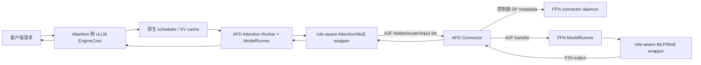

# Travel Through AFD

这是一份沿运行时数据流阅读 `afd-plugin` 的笔记。项目把 AFD（Attention-FFN Disaggregation）作为外部 vLLM 插件接入：请求仍进入 vLLM 的 Attention 侧，Attention 侧保留请求调度、KV cache 和最终输出，FFN 侧作为连接器驱动的守护进程运行。两侧通过同步或异步 connector 交换每层的 hidden states、路由信息、DP 元数据和 FFN 结果。

笔记中的标记含义：

- **源码事实**：可以在后面的源码路径、类名或函数名中直接定位。
- **设计契约**：来自 `docs/design/module/`，用于解释模块边界和预期时序；出现实现差异时以源码为准。
- **推断**：根据调用关系归纳出的运行时含义，单独标出。
- 测试和 E2E 在本次阅读中没有执行；文末列出可复现的验证入口。

## 0. 从哪里开始读

### 0.1 版本与阅读边界

- 检出范围：`main`，commit `4e729524c72639c4ef193455aab6cdf9d86e2f60`，提交时间 `2026-09-14 10:15:28 +08:00`。
- 本次核对时间：`2026-11-27 03:43:56 +08:00`。
- 目标上游：vLLM `0.26.0`；设计文档记录的 vLLM-Ascend commit 为 `80d8c194f`。
- 当前工作区已有用户未提交的 `.vscode/`，本笔记没有修改它。
- 这份笔记只描述 AFD 插件；低层 FlashAttention、MoE kernel 和 vLLM 原生调度器只追踪到 AFD 与它们的接口。

### 0.2 入口索引

建议按下面的顺序建立心智模型：

1. [插件边界设计](/media/lyxwxj/Data/common/Workspace/Omni-infra/Engine/afd-plugin/docs/design/module/plugin_boundary.md)：注册、配置、worker 选择。
2. [拓扑与 connector 契约](/media/lyxwxj/Data/common/Workspace/Omni-infra/Engine/afd-plugin/docs/design/module/connector_contracts.md)：rank、控制面、数据面和生命周期。
3. [Attention runtime](/media/lyxwxj/Data/common/Workspace/Omni-infra/Engine/afd-plugin/docs/design/module/attention_runtime.md) 与 [FFN runtime](/media/lyxwxj/Data/common/Workspace/Omni-infra/Engine/afd-plugin/docs/design/module/ffn_runtime.md)：两侧 worker、runner、ubatch 和 graph。
4. [Model integration](/media/lyxwxj/Data/common/Workspace/Omni-infra/Engine/afd-plugin/docs/design/module/model_integration.md)：模型层如何把本地 MoE 替换成远端 FFN 边界。
5. [Execution platforms](/media/lyxwxj/Data/common/Workspace/Omni-infra/Engine/afd-plugin/docs/design/module/execution_platforms.md)：CUDA/NPU、DBO、图捕获和异步 CAM。
6. [Compatibility and patches](/media/lyxwxj/Data/common/Workspace/Omni-infra/Engine/afd-plugin/docs/design/module/compatibility_and_patches.md)：为什么要 patch vLLM，以及 patch 何时生效。
7. [E2E testing](/media/lyxwxj/Data/common/Workspace/Omni-infra/Engine/afd-plugin/docs/design/module/e2e_testing.md)：硬件测试矩阵和限制。

### 0.3 顶层目录地图

```text
afd-plugin/
├── afd_plugin/
│   ├── __init__.py              # general_plugins 入口、模型注册、可选 spawn
│   ├── config.py                # afd additional_config -> AFDConfig
│   ├── validation.py            # worker/runner/platform 组合约束
│   ├── compat/                  # vLLM/vLLM-Ascend 版本适配和补丁
│   ├── connectors/              # base、metadata、factory、GPU/NPU 数据面
│   ├── distributed/             # rank 映射、私有 process group
│   ├── model_executor/          # role-aware 模型包装和 CAM 异步前向
│   └── v1/worker/               # Attention/FFN worker、runner、graph、ubatch
├── csrc/                        # NPU custom op 和 GPU 说明
├── docs/design/module/          # 模块契约和阅读导航
├── docs/gpu/, docs/npu/         # 平台运行、安装和 E2E 指南
├── tests/unit/                  # CPU-safe contract/unit tests
├── tests/e2e/                   # 硬件、多进程、模型 E2E
├── recipe/                      # 可运行配置和平台 recipe
└── setup.py, pyproject.toml     # plugin entry point 和打包
```

按运行时所有权可压缩成一张表：

| 问题 | 主要所有者 | 入口源码 |
| --- | --- | --- |
| 插件何时注册 | `register_afd()` | `afd_plugin/__init__.py` |
| AFD 配置如何进入 vLLM | `parse_afd_config()`、配置 patch | `afd_plugin/config.py`、`afd_plugin/compat/patches/config_validation.py` |
| 请求、KV、采样由谁负责 | Attention 侧 vLLM EngineCore/ModelRunner | `afd_plugin/v1/worker/attention_worker.py`、vLLM 原生类的父类调用 |
| FFN 如何启动 | FFN EngineCore patch + connector daemon | `afd_plugin/compat/patches/engine_core.py`、`afd_plugin/v1/worker/ffn_worker.py` |
| 跨角色数据如何传输 | `AFDConnectorBase` 的三种实现 | `afd_plugin/connectors/` |
| rank 和 DP/TP 如何映射 | `AFDRankMapping` | `afd_plugin/distributed/topology.py` |
| 模型哪一段放在哪一侧 | role-aware wrappers | `afd_plugin/model_executor/models/` |
| graph、DBO、ubatch 如何接入 | runner/metadata/wrapper | `afd_plugin/v1/worker/{attention_metadata,ubatch_wrapper,cuda_graph,dbo}.py` |

## 1. 先建立一句话架构



**源码事实**：Attention 侧调用模型前把 AFD metadata 放入 vLLM `ForwardContext.additional_kwargs["afd_metadata"]`；模型包装器中的 `RemoteFFNProxy` 从这个 sidecar 取出 metadata，调用 connector 发送 Attention 输出并等待 FFN 输出。[`afd_plugin/model_executor/models/forward_context.py`](/media/lyxwxj/Data/common/Workspace/Omni-infra/Engine/afd-plugin/afd_plugin/model_executor/models/forward_context.py)、[`deepseek_v2.py`](/media/lyxwxj/Data/common/Workspace/Omni-infra/Engine/afd-plugin/afd_plugin/model_executor/models/deepseek_v2.py)。

**推断**：AFD 的分离边界在模型的每层 FFN/MoE 子图附近，模型请求生命周期仍由 Attention 侧 vLLM 驱动；FFN 进程没有 API 请求队列和采样职责。

## 2. 插件加载：从 import 到可运行配置

### 2.1 `register_afd()` 是总入口

[`afd_plugin/__init__.py`](/media/lyxwxj/Data/common/Workspace/Omni-infra/Engine/afd-plugin/afd_plugin/__init__.py) 的 `register_afd()` 由 `pyproject.toml` 的 `vllm.general_plugins` entry point 调用。其顺序决定插件是否能在 vLLM 配置构造前把必要的行为接上：

1. 通过 `_registered` 保证幂等；若设置 `AFD_FORCE_SPAWN_MULTIPROCESSING=1`，先把 multiprocessing 默认方法切到 `spawn`，并处理 forkserver 重定向。
2. 读取 vLLM 版本并做非严格兼容检查；没有 vLLM 时保持 import-safe，便于 CPU-safe unit test。
3. 尝试加载 async DP engine、forward context、config validation、EngineCore 等 patch。
4. **必需**注册 AFD balanced routing strategy；DBO custom op、部分 NPU patch 属于 best-effort。
5. 根据 `_MODEL_REGISTRATIONS` 把原生架构映射到 `AFD...` 包装类，然后调用 vLLM `ModelRegistry.register_model()`。

模型注册表覆盖 DeepSeek、GLM MoE、Qwen3 MoE、Qwen3.5，并对 DeepSeek V4 按平台选择 CUDA/NPU wrapper。注册是“将 AFD 模型名暴露给 vLLM”，实际 role 选择仍由配置和 worker 初始化决定。

### 2.2 配置输入和归一化

[`afd_plugin/config.py`](/media/lyxwxj/Data/common/Workspace/Omni-infra/Engine/afd-plugin/afd_plugin/config.py) 把 `additional_config["afd"]` 解析成冻结的 `AFDConfig`。常用输入形态如下：

```json
{
  "afd": {
    "role": "attention | ffn",
    "connector": "P2pNcclAFDConnector | CAMP2pAFDConnector | CAMAsyncAFDConnector",
    "host": "127.0.0.1",
    "port": 29501,
    "num_attention_ranks": 1,
    "num_ffn_ranks": 1,
    "compute_gate_on_attention": false,
    "connector_extra_config": {}
  }
}
```

`AFDConfig` 还保存 `async_dp`、role、rank 数量、host/port 和 connector。`compute_hash()` 把 connector、async、role、rank 数量纳入配置 hash；通用字段之外的 connector 参数必须放到 `connector_extra_config`，避免上游配置 schema 被混用。解析函数会强制校验：

- role 必须为 `attention` 或 `ffn`；`expected_role` 不匹配直接失败。
- `async_dp=true` 只允许 `CAMAsyncAFDConnector`。
- P2P/CAMP2P 为 FFN-first 拓扑，并要求 `num_attention_ranks >= num_ffn_ranks`。
- host 非空、port 在 `1..65535`、rank 数为正数。

### 2.3 worker 自动选择和运行前契约

[`afd_plugin/validation.py`](/media/lyxwxj/Data/common/Workspace/Omni-infra/Engine/afd-plugin/afd_plugin/validation.py) 提供两层校验：

- `afd_worker_qualname_for_platform_default()` 在平台已经归一化后，把 CUDA 标准 worker 映射到 `AFDAttentionWorker`/`AFDFFNWorker`，把标准 Ascend `NPUWorker` 映射到 NPU AFD worker；310P/Xlite 等 worker 会明确拒绝。
- `assert_compatible_afd_stack()` 检查配置 role、worker FQCN、平台和 connector 的组合；`validate_gpu_model_runner_v2_config()`/`validate_npu_model_runner_v2_config()` 进一步约束 V2 runner。

GPU/NPU V2 契约都要求：无 PP/CP、`configured_ranks == DP * TP`、静态 expert parallelism、关闭 elastic EP/EPLB/sequence-parallel MoE、关闭 DBO/ubatching，并要求模型已注册。GPU V2 还要求 CUDA + 同步 P2P + `compute_gate_on_attention=false`；NPU V2 要求 NPU + 同步 CAMP2P。

## 3. 进程启动与所有权转移

### 3.1 Attention 侧

`AFDAttentionWorker.init_device()` 先验证 role、平台和 runner 版本，再根据 `use_v2_model_runner` 选择 V1/V2 AFD runner；它暂时把 vLLM 原生 `GPUModelRunner` 替换成 AFD 需要的类，调用父类初始化完成通用设备/模型构造后恢复原类名。这种临时替换是兼容 vLLM 初始化路径的 seam，具体见 [`afd_plugin/v1/worker/attention_worker.py`](/media/lyxwxj/Data/common/Workspace/Omni-infra/Engine/afd-plugin/afd_plugin/v1/worker/attention_worker.py)。

`AFDAttentionModelRunner.load_model()` 的顺序是：

1. 暂时安装 `AFDUBatchWrapper`（启用 ubatch 时）。
2. 让 native model load 完成权重加载。
3. 安装 AFD wrapper 和 connector。
4. 最后调用 `init_afd_connector()`，把 connector 初始化作为跨角色的权重加载屏障。

Attention 侧继续拥有 vLLM 原生 scheduler、KV cache/block table、request admission、prefill/decode 选择和最终 logits/output；AFD runner 在 `_model_forward()` 周围注入 metadata、控制面发送和 graph 状态。

### 3.2 FFN 侧

FFN 侧的 EngineCore 被 [`engine_core.py`](/media/lyxwxj/Data/common/Workspace/Omni-infra/Engine/afd-plugin/afd_plugin/compat/patches/engine_core.py) 改写为 connector daemon：构造 model executor 后提前返回，跳过 KV cache 初始化、scheduler、request block hasher 和普通请求队列。`AFDFFNWorker.initialize_from_config()` 把 KV cache block count 记录为 0/配置值但不初始化 KV，创建 connector 并启动后台 loop。

GPU 的 [`ffn_worker.py`](/media/lyxwxj/Data/common/Workspace/Omni-infra/Engine/afd-plugin/afd_plugin/v1/worker/ffn_worker.py) 线程阻塞等待 `recv_dp_metadata_list()`；收到 warmup/capture payload 时做 graph 操作，否则调用 `GPUFFNModelRunner.execute_model()`。FFN 侧若被 scheduler 直接调用 `execute_model()` 会 fail fast，因为它的正确驱动是 connector。

NPU 的 [`npu/ffn_worker.py`](/media/lyxwxj/Data/common/Workspace/Omni-infra/Engine/afd-plugin/afd_plugin/v1/worker/npu/ffn_worker.py) 分两路：有 control plane 的 CAMP2P 等待控制 payload；`CAMAsyncAFDConnector` 没有 control plane，则执行 `execute_connector_driven_step()`，由 CAM 数据面自己携带 work item。每个 step 后显式调用 `torch.npu.synchronize()`；CUDA loop 对应 `torch.cuda.synchronize()`。

### 3.3 rank 映射

[`afd_plugin/distributed/topology.py`](/media/lyxwxj/Data/common/Workspace/Omni-infra/Engine/afd-plugin/afd_plugin/distributed/topology.py) 的 `resolve_role_rank()` 先把 vLLM 的 DP/PCP/TP 坐标线性化：

```text
linear_rank = (dp_rank * pcp_size + pcp_rank) * tp_size + tp_rank
```

`build_rank_mapping()` 再生成 role rank、world rank、p2p rank、子组和 DP destination。同步 P2P/CAMP2P 的 global world 是：

```text
[F0, F1, ..., A0, A1, ...]
```

并把 Attention ranks 分成尽量均衡的连续块；要求 `A >= F`，任意两个 FFN block 的 Attention 数量差不超过一个。CAM async 使用 Attention-first world：

```text
[A0, A1, ..., F0, F1, ...]
```

这个顺序不能只看类名推断，必须与 connector 实现的 rank mapping 一起读。

## 4. 一次请求如何穿过系统

下面追踪一条 Attention 请求在同步连接器上的主路径；请求 admission 和 KV 操作属于 vLLM 父类，AFD 从 metadata 边界开始接管。

```text
API request
  -> vLLM EngineCore / Scheduler
  -> Attention worker: native batch + KV block table
  -> AFD runner builds per-ubatch AFDForwardContextMetadata
  -> set_forward_context(... additional_kwargs["afd_metadata"])
  -> role-aware model layer computes attention/residual
  -> RemoteFFNProxy or GateOnlyRemoteMoE
  -> connector.send_attn_output(A2F hidden/router/input_ids)
  -> connector control plane carries DP metadata and graph flags
  -> FFN worker receives DP payload
  -> FFN runner receives A2F payload, runs local MLP/MoE
  -> connector.send_ffn_output(F2A output)
  -> Attention connector.recv_ffn_output()
  -> model layer restores residual/next layer
  -> native final norm/lm head/logits
  -> vLLM sampler / output processor
  -> API response
```

### 4.1 metadata sidecar

[`afd_plugin/connectors/metadata.py`](/media/lyxwxj/Data/common/Workspace/Omni-infra/Engine/afd-plugin/afd_plugin/connectors/metadata.py) 定义了几种不同生命周期的数据：

- `AFDDPMetadata`：CPU `int32` token counts、最大 token 数和 SP local/chunk size。
- `AFDControlPayload`：按 stage 携带 DP metadata，以及 `is_graph_capturing`、`is_warmup`、`is_graph_replaying`、`is_profile`。
- `AFDTransferMetadata`：layer/stage、正数 `seq_lens`、total token 数和 shape 检查。
- `AFDTransferContext`：transfer metadata 加可选 backend state。
- `AFDA2FTransferPayload`/`AFDF2ATransferPayload`：A2F/F2A 张量和可选 router/input IDs。
- `AFDForwardContextMetadata`：token/request starts 和 lens、stage、connector、stage 数、transaction id；`clone()` 会复制列表，避免 ubatch 子上下文共享可变 list。

Attention runner 的 metadata provider 把这些对象写入 vLLM `ForwardContext.additional_kwargs`；`model_executor/models/forward_context.py` 中的 `get_afd_metadata_from_forward_context()` 是模型包装器唯一的取数入口之一。

### 4.2 控制面与数据面

同步 connector 把“这一批应该接收什么、是否处于 graph capture”放在控制面，把 hidden/router/FFN output 放在数据面。`AFDConnectorBase` 的最小契约是：

```text
Attention: send_attn_output(), recv_ffn_output()
FFN:       recv_attn_output(), send_ffn_output()
Control:   update_state_from_dp_metadata(),
           send_dp_metadata_list(), recv_dp_metadata_list()
```

`AFDConnectorFactory.create_connector()` 延迟导入具体 connector，解析 active config，按 `resolve_role_rank()` 得到 role rank，再实例化。connector 构造时只保存 rank/config/typed extra info；真正的 process group、communicator、buffer 在 `init_afd_connector()` 建立，`close()` 释放。

### 4.3 完成语义

源码中的 `send_*`/`recv_*` 是通信操作提交和张量交付边界，不等价于所有 device work 已完成：

- CUDA FFN loop 在每个控制 payload 对应的执行后调用 `torch.cuda.synchronize()`。
- NPU FFN loop 在每个 sync/CAM step 后调用 `torch.npu.synchronize()`。
- connector custom op 内部可能有 NCCL/HCCL stream 和 graph buffer；Python 返回表示调用完成，设备可见性仍由 backend op 和显式 synchronize 决定。
- CAM async 使用 FIFO pending queue 和算子内部 overlap；代码没有把每个 layer 暴露成 Python `Future`、event 或 ticket。

这一区分很重要：逻辑上某个 stage 的 F2A 结果已经可消费，不能据此推断同一时刻 host、通信 stream 和计算 stream 都已完全空闲。

## 5. Attention runtime：batch、ubatch、graph 和 KV

### 5.1 metadata 构造

[`afd_plugin/v1/worker/attention_metadata.py`](/media/lyxwxj/Data/common/Workspace/Omni-infra/Engine/afd-plugin/afd_plugin/v1/worker/attention_metadata.py) 的 `AFDMetadataProviderMixin` 在原生 batch 上切出 ubatch，填充每个 stage 的 token/request starts/lens、stage index 和 transaction id。`send_dp_metadata()` 先更新本地 control state，再把各 stage 的 DP payload 发给 FFN。

DP=1 时，`_ensure_dp_metadata()` 用 pending metadata 构造本地 fallback，避免为了单卡 Attention 额外建立 native DP metadata。graph capture 通过 `build_capture_dp_metadata()` 生成统一 padded count；replay 时仍使用 capture 形状，实际 token 数由 metadata 解释。

当启用多 ubatch 时，`_build_attention_metadata()` 临时关闭 native metadata builder 的 `supports_update_block_table`，防止多个 AFD 子 batch 复用同一份 block table/cache 更新状态，随后在 `finally` 中恢复上游设置。这是 AFD 对 vLLM metadata cache 生命周期的局部隔离。

### 5.2 ubatch 包装

[`afd_plugin/v1/worker/ubatch_wrapper.py`](/media/lyxwxj/Data/common/Workspace/Omni-infra/Engine/afd-plugin/afd_plugin/v1/worker/ubatch_wrapper.py) 的 `AFDUBatchWrapper`：

1. AFD active 时关闭 SM partitioning。
2. 在 native forward 分片前安装 AFD metadata。
3. 建立每个 child ubatch 的 `ForwardContext` 和 AFD metadata clone。
4. 保留 native stream/barrier 语义。
5. 让每个 child 使用独立 stage/transaction 视图，但共享上游要求的 token layout。

GPU AFD 的 ubatching 契约是**恰好两个 ubatch**；`fail_if_unsupported_ubatching()` 对其它数量直接报错。native DBO yield custom op 只注册一次，调用 CUDA/NPU DBO yield；它服务于两个 ubatch 的交错推进。

### 5.3 CUDA graph

[`afd_plugin/v1/worker/cuda_graph.py`](/media/lyxwxj/Data/common/Workspace/Omni-infra/Engine/afd-plugin/afd_plugin/v1/worker/cuda_graph.py) 的状态机是 `EAGER -> WARMUP -> CAPTURE -> REPLAY`，当前 AFD 支持策略为 `FULL_DECODE_ONLY`；启用 ubatch 时仍要求两个 ubatch。Attention runner 在 `_warmup_and_capture()`：

- 设置 `_is_warmup` 和 capture/replay flags。
- 在真正 graph capture 前发送一次静态 AFD control payload。
- 用 `_afd_suppress_metadata_send` 避免 capture 内重复发送同一控制面消息。
- 把 capture payload 保留给 replay。

FFN runner 按 DP metadata 计算 `make_ffn_graph_key()`，在 capture 前更新 connector control state；graph cache 以 metadata 形状为 key。graph replay 只复用相同形状的预分配 buffer，不能把不同 token shape 当作同一 capture。

### 5.4 Attention 的 cache 所有权

**源码事实**：Attention 继承/调用 vLLM 原生 ModelRunner，因此保留 KV cache、block table、prefix cache、scheduler 的 ownership；FFN `get_kv_cache_spec()` 返回空字典，`initialize_kv_cache()` 是 no-op。[`attention_worker.py`](/media/lyxwxj/Data/common/Workspace/Omni-infra/Engine/afd-plugin/afd_plugin/v1/worker/attention_worker.py)、[`ffn_model_runner.py`](/media/lyxwxj/Data/common/Workspace/Omni-infra/Engine/afd-plugin/afd_plugin/v1/worker/ffn_model_runner.py)。

**推断**：同一请求的 prefill/decode、请求抢占和 prefix reuse 必须由 Attention 侧 vLLM 继续解释；FFN 只看到某一层某一 stage 的张量和 token metadata，不持有能单独重建请求状态的 KV block。

## 6. FFN runtime：无请求调度的计算服务

### 6.1 GPU FFN loop

[`afd_plugin/v1/worker/ffn_worker.py`](/media/lyxwxj/Data/common/Workspace/Omni-infra/Engine/afd-plugin/afd_plugin/v1/worker/ffn_worker.py) 的 daemon loop 的主要状态转移是：

```text
thread start
  -> set CUDA device
  -> require control plane
  -> recv_dp_metadata_list()
  -> warmup/capture ? capture_model() : execute_model()
  -> torch.cuda.synchronize()
  -> repeat
```

线程错误存到 runner/worker 的 error slot，由主线程的 `raise_ffn_loop_error_if_any()` 暴露；停止时设置 event、调用 `model_runner.shutdown()`、等待最多约 5 秒，再把线程错误重新抛出。EngineCore patch 的 `shutdown()` 会走这条路径，并避免访问没有初始化的 scheduler/KV 属性。

### 6.2 GPU FFN runner

[`afd_plugin/v1/worker/ffn_model_runner.py`](/media/lyxwxj/Data/common/Workspace/Omni-infra/Engine/afd-plugin/afd_plugin/v1/worker/ffn_model_runner.py) 的 `_ffn_forward()` 对每个 layer/stage：

1. 用 control payload 更新 connector state。
2. 从拓扑和 Attention DP token counts 聚合 FFN 侧 metadata。
3. `recv_attn_output()` 得到 A2F transfer payload。
4. 把 `AFDTransferMetadata` 写入当前 forward context。
5. 运行 native FFN，或在 external-router 模式下运行 experts。
6. `send_ffn_output()` 按 peer 的 `seq_lens` 拆分返回。

`compute_gate_on_attention=true` 时只让 FFN 执行 expert 计算，gate/top-k 已在 Attention 侧完成；不同模型对这个模式的支持不同，不能只看 connector 是否允许。

### 6.3 NPU FFN loop

CAMP2P 同步路径与 GPU 类似：控制面收到 DP metadata，`AFDNPUFFNModelRunner.execute_ffn_step()` 为每个 layer/stage 建立 Ascend forward context，接收 A2F、计算、发送 F2A。

CAM async 没有独立控制面，`execute_connector_driven_step()` 在 [`afd_plugin/v1/worker/npu/ffn_model_runner.py`](/media/lyxwxj/Data/common/Workspace/Omni-infra/Engine/afd-plugin/afd_plugin/v1/worker/npu/ffn_model_runner.py) 中循环：

```text
recv_ffn_work_item()
  -> 取 layer/stage/token counts/group_list/scales/shared
  -> 构造 Ascend forward context
  -> compute_ffn_output(...)
  -> send_ffn_work_item_output()
```

FFN worker 在 shutdown 时先 `connector.close()` 再 join，因为 CAM 的 receive 可能阻塞；这一步是异步连接器的关闭解除阻塞手段。

## 7. 三种 connector：同一契约下的三套数据面

### 7.1 对照表

| Connector | 设备/通信 | world 顺序 | 控制面 | Attention 行为 | FFN 行为 |
| --- | --- | --- | --- | --- | --- |
| `P2pNcclAFDConnector` | CUDA NCCL/custom op | FFN-first | 独立 NCCL metadata group | 发送 hidden/router/ids，接收 F2A | 从每个 Attention peer 接收、拼接、计算、拆回 |
| `CAMP2pAFDConnector` | NPU HCCL custom op + Gloo metadata | FFN-first | Gloo metadata group | HCCL A2E/E2A，Gloo 传 DP metadata | 依据 per-ubatch token count 执行 HCCL transfer |
| `CAMAsyncAFDConnector` | NPU HCCL CAM async | Attention-first | `control_plane=None` | `async_dispatch_send`，FIFO pending | `async_dispatch_recv`，CAM combine send |

三者都实现 [`AFDConnectorBase`](/media/lyxwxj/Data/common/Workspace/Omni-infra/Engine/afd-plugin/afd_plugin/connectors/base.py)；差异集中在 process group、buffer、metadata 传输和 operator state。

### 7.2 CUDA P2P

[`afd_plugin/connectors/gpu/p2p.py`](/media/lyxwxj/Data/common/Workspace/Omni-infra/Engine/afd-plugin/afd_plugin/connectors/gpu/p2p.py) 的初始化阶段：

1. 根据 `AFDRankMapping` 建立 AFD NCCL world。
2. 创建 Attention/FFN subgroup 的 `StatelessProcessGroup`。
3. 建立 A2E/E2A `PyNcclCommunicator`，注册 communicator IDs。
4. 建立 `P2pNcclAFDControlPlane` 的 metadata group。
5. 为 graph/replay 准备按 stage、peer、大小索引的 receive buffer。

Attention 发送 hidden states，并可附带 router logits/input IDs；FFN 对每个 Attention peer 接收后拼接，计算完成后按 `seq_lens` 拆分返回。`_recv_hidden_states()` 优先复用调用方给的 `ref_tensor`，前提是 shape/dtype/device 相同，目的是稳定 graph allocation。

### 7.3 NPU CAMP2P

[`afd_plugin/connectors/npu/camp2p.py`](/media/lyxwxj/Data/common/Workspace/Omni-infra/Engine/afd-plugin/afd_plugin/connectors/npu/camp2p.py) 用 HCCL 做数据传输，用 Gloo 传 DP metadata。`CAMP2PTransferState` 保存 custom op 需要的 `aiv_num`、batch/hidden/h 参数、attention batch、active mask 和 endpoint。

`recv_attn_output()` 根据控制面中的 DP metadata 计算当前 FFN peer 的 token 数，调用 `torch.ops.afd_ascend.a2e` 并保存返回 state；`send_ffn_output()` 使用同一 state 调用 e2a。当前 typed extra config 支持 core 数、role core 数、HCCL buffer、quant mode 等，但 validation 会拒绝 `compute_gate_on_attention` 和非零 quant 的不支持组合。

### 7.4 NPU CAM async

[`afd_plugin/connectors/npu/async_cam.py`](/media/lyxwxj/Data/common/Workspace/Omni-infra/Engine/afd-plugin/afd_plugin/connectors/npu/async_cam.py) 的设计是 eager-only 的 HCCL 异步 MoE 数据面：

- Attention 根据 top-k 做 dispatch-send，随后按 FIFO 等待 combine-recv。
- FFN 做 dispatch-recv、本地 experts、combine-send。
- dispatch metadata 随 CAM operator 产生，不另开 DP control plane。
- `AFDAsyncExtraInfo` 保存 dynamic quant、每个 DP 的 Attention rank 数、两 stage async MoE ubatch 参数和 HCCL buffer。
- `AFDAsyncTransferState` 保存 batch/hidden/top-k/layer 以及 `token_nums_rankid_layeridx`、`expert_token_nums_shared`、`group_list`、scale 等 operator state。

Attention `send_attn_output()` 把 `(context, topk_ids, topk_weights)` 按 stage 放入 pending queue 并调用 `async_dispatch_send()`；`recv_ffn_output()` 没有显式 kwargs 时按 FIFO 弹出，调用 `async_combine_recv()`。

FFN `recv_ffn_work_item()` 通过一次 D2H stack 读取四个 CAM control scalar，再把 operator capacity tensor 切成当前 layer/stage 的 view。零 routed token 也必须可运行；由于 CAM combine-send 不能消费空/int8 输入，`send_ffn_work_item_output()` 会发送一个 fake BF16 token，并修正 metadata 中的 seq len。

## 8. 模型包装：怎样把本地 MoE 改成远端 FFN

### 8.1 通用 role split

[`afd_plugin/model_executor/models/model_utils.py`](/media/lyxwxj/Data/common/Workspace/Omni-infra/Engine/afd-plugin/afd_plugin/model_executor/models/model_utils.py) 根据原生 architecture 生成带 `AFD` 前缀的 model config；包装模型在构造层时读取 `AFDConfig.role`：

- Attention role 构造 self-attention、residual、embedding、最后 norm/lm head，以及 RemoteFFNProxy 或 Attention-side gate。
- FFN role 构造 PPMissing attention、native MLP/MoE experts，跳过 Attention 的请求侧组件。
- `load_weights()` 按 role 过滤，只加载该侧需要的权重；跨角色共享权重的处理由具体模型 wrapper 定义。

### 8.2 DeepSeek 路径

[`afd_plugin/model_executor/models/deepseek_v2.py`](/media/lyxwxj/Data/common/Workspace/Omni-infra/Engine/afd-plugin/afd_plugin/model_executor/models/deepseek_v2.py) 的核心调用：

```text
RemoteFFNProxy.forward()
  -> get_afd_metadata_from_forward_context()
  -> build AFDTransferMetadata / AFDTransferContext
  -> connector.send_attn_output()
  -> optional DBO yield
  -> connector.recv_ffn_output(ref_tensor, ubatch_idx)
```

`AFDAttentionFusedMoE` 和 `GateOnlyRemoteMoE` 支持把 router logits/top-k 留在 Attention，再把路由结果随 A2F 一起发送。`AFDDeepseekV2DecoderLayer` 根据 role 只构造本地计算路径；`AFDDeepseekV2Model` 在异步 CAM 配置下把 forward 委托给 `deepseek_v2_async_cam_forward`，并在 `load_weights()` 中按 role 过滤。

### 8.3 Qwen 与平台限制

- `qwen3_moe.py` 是 CUDA-only wrapper：关闭 Attention-side gate、SP MoE、EPLB、PP、speculative decoding、LoRA 等不支持组合。
- `qwen3_5.py` 是 CUDA text-only wrapper，Attention 侧拥有 embeddings/norm/lm head，FFN 侧运行 native MoE。
- DeepSeek V4 有 CUDA/NPU 分支和 async forward contract；具体低层 operator 不属于这份阅读笔记的主线。

这些限制由模型 wrapper 的 `_validate_supported_config()`、`validation.py` 和 E2E recipe 共同形成；不能只根据 `AFDConfig.connector` 推断模型可运行。

## 9. NPU CAM async：两个时间轴的交错

### 9.1 普通异步 forward

[`afd_plugin/model_executor/models/npu/deepseek_v2_async_cam_forward.py`](/media/lyxwxj/Data/common/Workspace/Omni-infra/Engine/afd-plugin/afd_plugin/model_executor/models/npu/deepseek_v2_async_cam_forward.py) 的普通 async 路径保持一个跨 layer 的 pipeline：

```text
layer i:
  recv 前一层 FFN 结果
  计算当前 Attention
  发送当前层 top-k/hidden
  继续下一层
最后一层后再 recv 最后的 FFN 结果
```

这段代码把通信和下一层 Attention 计算重叠；它仍通过 AFD metadata 绑定 layer/stage，避免把上一层结果误配到下一层。

### 9.2 async MoE ubatching

[`afd_plugin/model_executor/npu/async_cam_ubatching.py`](/media/lyxwxj/Data/common/Workspace/Omni-infra/Engine/afd-plugin/afd_plugin/model_executor/npu/async_cam_ubatching.py) 的 `plan_async_moe_stages()` 把连续请求边界或 token-balanced 边界规划成两个 `AsyncMoeStage`。布局辅助文件 [`async_cam_layout.py`](/media/lyxwxj/Data/common/Workspace/Omni-infra/Engine/afd-plugin/afd_plugin/model_executor/models/npu/async_cam_layout.py) 负责：

- 校验 stage 非空、连续、无重叠。
- 处理 TP replicated 与 sequence-parallel layout。
- 对 stage input 做 gather/slice/pad。
- 对 CAM 输出 all-gather、trim 并恢复 parent layout。

`run_async_moe_ubatch_afd_forward()` 先处理 dense prefix，再对连续 MoE block 做两 stage pipeline；每个 stage 有自己的 `stage_idx`、实际/填充 token 数和 context，且显式关闭 native DBO，避免两个 pipeline 机制同时推进同一份 state。

## 10. 生命周期、buffer 和错误路径

下面把“谁拥有、何时建立、如何复用、何时可见、如何释放”放在一张表中。`完成`区分逻辑交付和设备同步。

| 资源/状态 | owner | 建立 | 复用/可见性 | 释放 |
| --- | --- | --- | --- | --- |
| 请求队列、采样状态 | vLLM Attention EngineCore | native engine 启动 | scheduler 决定 batch；AFD 不复制 | vLLM engine shutdown |
| KV cache/block table | Attention ModelRunner/vLLM worker | Attention cache init | prefill/decode、prefix reuse 由 vLLM 管理 | native runner shutdown |
| AFD control metadata | connector control plane 或 CAM dispatch state | `send_dp_metadata_list()` / CAM operator | sync 通过 NCCL/Gloo payload；async 随 operator state | `connector.close()` |
| `AFDForwardContextMetadata` | Attention metadata provider + child ubatch | 每个 batch/stage 构造 | clone 到 child，写入 `additional_kwargs` | 当前 forward scope 结束 |
| CUDA graph | Attention/FFN runner graph cache | warmup/capture 前准备控制面 | key 由 padded/DP token metadata 决定；replay 复用静态 buffer | runner shutdown 清空 |
| NPU ACL graph | NPU Attention/FFN runner | capture step | 按聚合 FFN metadata key 复用 | runner shutdown |
| P2P receive buffer | CUDA connector | connector init/control state | `_recv_hidden_states()` 可复用 ref tensor，图捕获需稳定地址 | communicator/group/缓存关闭 |
| CAMP2P transfer state | NPU connector | 每次 A2E/E2A 前后 | per-ubatch custom op state | connector close |
| CAM pending queue | `CAMAsyncAFDConnector` | Attention dispatch-send | FIFO pop 与 combine-recv 配对 | close 解除 receive/blocking |
| daemon thread | FFN worker | `initialize_from_config()` | 每个控制/数据 step 后 device synchronize | stop event、connector close、join |

### 10.1 取消、抢占、退出

**源码事实**：仓库没有 AFD 自有的请求取消或抢占协议；EngineCore patch、Attention scheduler 和 KV connector 仍由 vLLM 负责请求生命周期。connector 的 `close()`、FFN loop stop 和 EngineCore `shutdown()` 处理的是进程/服务关闭，不是单请求 cancellation。

**推断**：当 vLLM scheduler 抢占或延迟请求时，Attention 会以新的 batch metadata 重新驱动 connector；FFN 不能独立决定保留哪个请求的 KV 或回滚哪个采样状态。若未来需要跨角色取消，必须在 control/data contract 中增加 request/stage transaction 的取消语义，当前 `transaction_id` 只用于 metadata 配对。

### 10.2 speculative decoding

AFD 本身没有 draft/verify/rollback 的实现。vLLM 的 `speculative_config` 仍在原生 EngineCore/ModelRunner 侧存在，但当前验证的 Qwen3 MoE CUDA wrapper 明确拒绝 speculative decoding；NPU/DeepSeek 的 native metadata 可能把 `use_spec_decode` 透传给上游路径，但这不等于 AFD connector 能回滚已发送的 layer payload。阅读或扩展该能力时，应同时检查：

- `afd_plugin/v1/worker/attention_model_runner.py` 的 `use_spec_decode` metadata 分支。
- `afd_plugin/model_executor/models/qwen3_moe.py` 的配置拒绝。
- connector 是否有按候选 token 撤销/重放的协议；当前没有。

## 11. vLLM 兼容补丁：为什么能嵌进外部插件

### 11.1 版本目标和 patch 边界

[兼容层设计说明](/media/lyxwxj/Data/common/Workspace/Omni-infra/Engine/afd-plugin/docs/design/module/compatibility_and_patches.md) 记录的目标是 vLLM `0.26.0`，并要求只在插件边界内 patch，不改 vLLM 源树。每个源码 patch 函数上方都有 patch reason/functionality/signature 注释，差异用 `# ### PATCH START/END` 标记，便于随上游 tag 重拷贝。

### 11.2 配置和 worker patch

[`afd_plugin/compat/patches/config_validation.py`](/media/lyxwxj/Data/common/Workspace/Omni-infra/Engine/afd-plugin/afd_plugin/compat/patches/config_validation.py) 对 EngineArgs/VllmConfig 做两件事：

- AFD ubatching 在非 DeepEP backend 下，临时以 `deepep_low_latency` 形态通过上游 all2all validation，再恢复用户实际 backend。
- 在平台 worker 已归一化后，把 `worker_cls="auto"` 替换为 role/platform 对应的 AFD worker。

这解释了为什么 README 要求 general plugin 在 VllmConfig 构造前加载；如果 patch 迟到，`validation.py` 会发现 worker 仍是 `auto` 并失败。

### 11.3 FFN EngineCore patch

`engine_core.py` 的 FFN 分支：

```text
AFD FFN VllmConfig
  -> construct executor/model runner
  -> skip KV cache + scheduler setup
  -> start connector-driven FFN loop
  -> shutdown: stop loop -> executor.shutdown -> cleanup
```

普通非 AFD 配置继续复制目标上游 `EngineCore.__init__`/`shutdown` 逻辑。这个 patch 的风险是上游 EngineCore 字段发生变化时，FFN 分支和普通分支可能同时需要重拷贝；不能用 `_original_*` delegation 代替长期的签名和字段对齐。

### 11.4 async DP patch

- `async_dp_engine.py` 让 AFD async Attention 在 MoE DP 场景使用普通 `EngineCoreProc`，保留 DP rank 元数据但跳过 vLLM native DP wave/coordinator wakeup。
- `async_dp_forward_context.py` 在 `set_forward_context()` 中只对 AFD async config 跳过 native `DPMetadata` 创建；普通 DP/sequence-parallel MoE 保持上游逻辑。

设计文档把这些 patch 视为过渡层：当上游暴露 role-specific async DP hook 或非 lockstep stats 后，应逐步删除。当前实现仍有 grouped import/best-effort patch 的部分失败风险，因此注册入口要区分 required patch 和 best-effort patch。

### 11.5 NPU runtime patch

`afd_plugin/compat/npu/runtime.py` 在 Ascend config/worker startup 时应用 async DP、all2all、force load balance、MLA graph 等 patch。NPU worker 会在 `init_device()` 之后应用这些 patch，避免 import 阶段提前触碰不存在的 Ascend runtime。CAM async 还依赖 `AFD_FORCE_SPAWN_MULTIPROCESSING=1` recipe 来规避 fork 后的设备 runtime 状态继承。

## 12. 运行能力与已知边界

### 12.1 配置能力矩阵

| 路径 | 主要组合 | 关键边界 |
| --- | --- | --- |
| CUDA V1 Attention/FFN | P2P NCCL | graph 仅 `FULL_DECODE_ONLY`；ubatch 恰好 2 |
| CUDA V2 | P2P、无 DBO/ubatch、静态 EP | DP×TP 必须等于 A/F 配置 rank；不支持 PP/CP |
| NPU V1 sync | CAMP2P HCCL/Gloo | 依赖 Ascend worker、workspace 和 custom op |
| NPU V1 async | CAMAsync HCCL | eager-only；无 native DBO/ACL graph；control plane 为 `None` |
| Qwen3 MoE CUDA | AFD Qwen3 wrapper | text-only 约束之外，拒绝 spec decode、LoRA、PP、SP MoE/EPLB 等 |
| Qwen3.5 CUDA | AFD Qwen3.5 wrapper | text-only；MoE/TP 组合按 wrapper 校验 |
| DeepSeek 系列 | DeepSeek V2/V4 wrappers | gate-on-Attention、CAM async 和平台支持取决于具体模型/recipe |
| 多模态/NPU 未验证路径 | 设计文档列出限制 | 不能从模型注册存在推断 E2E 已通过 |

### 12.2 常见阅读陷阱

- `control_plane=None` 表示 CAM async 的 connector-driven contract，不表示没有 metadata；metadata 随 dispatch/receive operator state 流动。
- `send_attn_output()` 返回并不表示 FFN 已完成；要看后续 `recv_ffn_output()`、worker synchronize 和 graph mode。
- FFN 的“无 KV cache”不代表 FFN 无 state；它仍保存 connector communicator、transfer metadata、graph cache、operator state 和错误状态。
- AFD metadata 在 `additional_kwargs` sidecar 中，不要把它当成 vLLM `ForwardContext` 的永久公共字段。
- AFD ubatch 与 native DBO 有交互；CAM async 的两 stage pipeline 另有 `AsyncMoeStage`，不能用 GPU 两 ubatch 的代码路径解释它。
- 设计文档说明意图，真正的支持范围还要同时查 `validation.py`、模型 wrapper 的 `_validate_supported_config()` 和对应 unit/E2E recipe。

## 13. 验证入口和证据边界

本次只做静态源码阅读，没有运行 vLLM、CUDA、NPU 或多进程 E2E。硬件、模型权重和 pinned runtime 的可用性尚未验证。

### 13.1 推荐的 CPU-safe/contract 检查

```bash
cd /media/lyxwxj/Data/common/Workspace/Omni-infra/Engine/afd-plugin
uv run pytest tests/unit/config tests/unit/distributed tests/unit/connectors
uv run pytest tests/unit/compat/patches tests/unit/v1/worker
uv run pytest tests/unit/model_executor
uv run ruff check .
```

重点测试入口：

- 配置/拓扑：[`tests/unit/config/test_config.py`](/media/lyxwxj/Data/common/Workspace/Omni-infra/Engine/afd-plugin/tests/unit/config/test_config.py)、[`test_validation.py`](/media/lyxwxj/Data/common/Workspace/Omni-infra/Engine/afd-plugin/tests/unit/config/test_validation.py)、[`tests/unit/distributed/test_topology.py`](/media/lyxwxj/Data/common/Workspace/Omni-infra/Engine/afd-plugin/tests/unit/distributed/test_topology.py)。
- connector：[`tests/unit/connectors/test_p2p_connector.py`](/media/lyxwxj/Data/common/Workspace/Omni-infra/Engine/afd-plugin/tests/unit/connectors/test_p2p_connector.py)、`test_camp2p_connector.py`、`test_async_cam_connector.py`。
- worker/graph/metadata：[`tests/unit/v1/worker/test_attention_model_runner.py`](/media/lyxwxj/Data/common/Workspace/Omni-infra/Engine/afd-plugin/tests/unit/v1/worker/test_attention_model_runner.py)、`test_ffn_model_runner.py`、`test_cuda_graph.py`、`test_dbo.py`、`test_model_runner_v2.py`。
- model contract：`tests/unit/model_executor/models/` 下的 DeepSeek/Qwen construction、proxy、weight policy 和 async forward tests。
- patch 行为：`tests/unit/compat/patches/test_engine_core.py`、`test_config_validation.py`、`test_async_dp_engine.py`、`test_async_dp_forward_context.py`。

### 13.2 硬件 E2E

E2E 入口在 [`tests/e2e/runner.py`](/media/lyxwxj/Data/common/Workspace/Omni-infra/Engine/afd-plugin/tests/e2e/runner.py) 和 `tests/e2e/README.md`；执行前需按 [E2E testing 设计](/media/lyxwxj/Data/common/Workspace/Omni-infra/Engine/afd-plugin/docs/design/module/e2e_testing.md) 准备 pinned vLLM/vLLM-Ascend、模型权重、GPU/NPU、rank 数、host/port 和 recipe。GPU graph、Qwen3 MoE CUDA、DeepSeek-V2-Lite GPU/NPU、Qwen3.6 MoE CUDA 等场景有不同 opt-in 条件；CAM async 不能套用 native DBO/PCP 的验证命令。

本笔记没有把“存在测试文件”写成“测试通过”。实际通过状态应在运行命令后补充日期、commit、设备、配置和日志路径。

## 14. 继续阅读时最值得追的三条线

1. **配置到进程**：`register_afd()` → `config_validation.py` → `validation.py` → `EngineCore` patch → worker `init_device()`。这条线可以回答“为什么一个 JSON 配置会决定两个不同的进程形态”。
2. **一层 MoE 的数据往返**：`AFDMetadataProviderMixin` → `RemoteFFNProxy.forward()` → connector `send/recv` → FFN runner → model `compute_ffn_output()`。这条线可以回答“token shape、layer/stage、DP metadata 如何保持配对”。
3. **异步设备状态**：CAM pending queue / operator state → `AsyncMoeStage` → NPU forward context → `torch.npu.synchronize()`。这条线可以回答“逻辑完成、通信完成、设备完成分别在哪里可见”。

如果要修改项目，优先从这三条线确定 owner 和 contract，再决定是 patch vLLM、继承 runner、扩展 connector，还是新增 model wrapper。任何跨角色状态都需要同时说明创建者、消费者、shape/transaction key、设备可见性和关闭路径。
